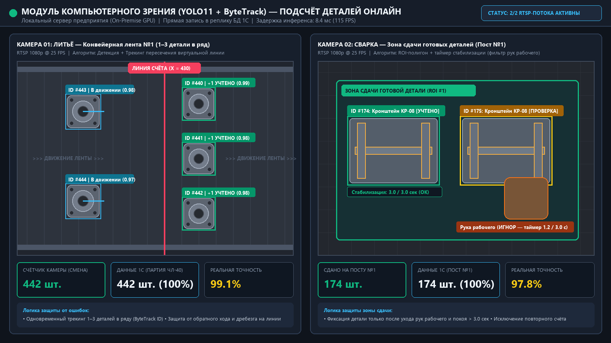
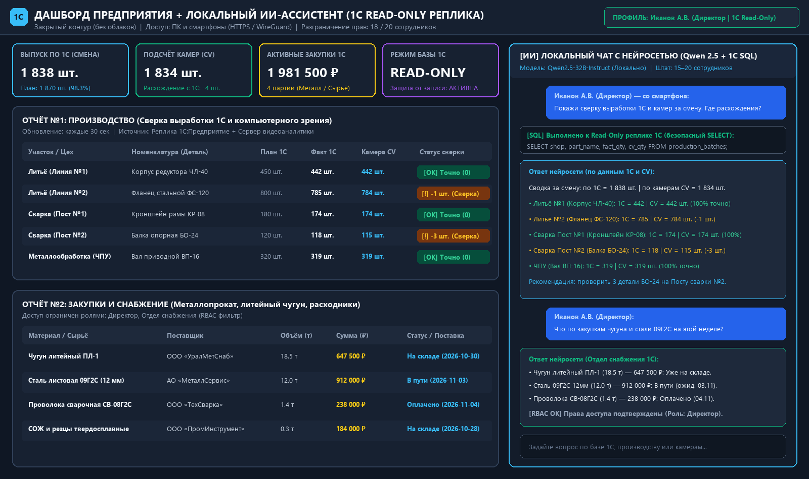

# Промышленный ИИ-контур: Локальная нейросеть + Отчёты 1С (Read-Only) + Компьютерное зрение (CV)

> 🚀 **[ОТКРЫТЬ ИНТЕРАКТИВНЫЙ ОНЛАЙН ДЕМО-СТЕНД В БРАУЗЕРЕ](https://h3h-holylord.github.io/factory-ai-1c-cv/)**
> *(Доступны: онлайн-симуляция камер литья и сварки, переключение ролей сотрудников RBAC, отчёты 1С и чат с нейросетью)*

Полностью автономное (On-Premise / Air-Gapped) решение для производственного предприятия (металлообработка, литьё, сварка). Данные не покидают контур сервера предприятия.

## Визуализация работы модулей

### 1. Модуль компьютерного зрения (Литьё: 1–3 детали в ряд на ленте + Сварка: зона сдачи ROI)


### 2. Дашборд 1С (Производство и Закупки) + Локальный чат с разграничением прав (15–20 сотрудников)


---

## Архитектура и состав проекта

1. **Модуль компьютерного зрения ([`src/cv_counter.py`](src/cv_counter.py))**:
   - `ConveyorCounter`: подсчёт литых деталей (1–3 в ряд на конвейерной ленте) по пересечению виртуальной линии с трекингом ID и защитой от повторного счёта/дребезга.
   - `WeldingZoneCounter`: контроль зоны сдачи готовых сварных узлов (ROI) с фильтрацией рук рабочего и подтверждением фиксации по таймеру (`confirm_frames`).
2. **Модуль Read-Only реплики 1С и RBAC-доступа ([`src/db_1c.py`](src/db_1c.py))**:
   - Жёсткая блокировка любых модифицирующих запросов (`INSERT`, `UPDATE`, `DELETE`, `DROP`) на уровне границы данных (`validate_readonly_sql`).
   - Ролевая модель доступа (RBAC) для 15–20 сотрудников (`director`, `production`, `procurement`).
   - Локальный ИИ-ассистент (Qwen 2.5 через Ollama) с формированием безопасных `SELECT`-запросов к выгрузке 1С.
3. **Интерактивный веб-стенд ([`src/live_server.py`](src/live_server.py) / [`index.html`](index.html))**:
   - Живая демонстрация работы камер, ролевого фильтра и ИИ-чата по базе 1С.

---

## Инструкция по установке с нуля (Runbook)

### Вариант А: Развёртывание в Docker (Боевой / Тестовый сервер)
```bash
# 1. Клонировать проект на локальный сервер
git clone https://github.com/H3H-holylord/factory-ai-1c-cv.git
cd factory-ai-1c-cv

# 2. Запустить изолированный контур
docker compose up -d

# 3. Загрузить локальную языковую модель Qwen 2.5 в контейнер Ollama
docker exec -it factory-ollama ollama pull qwen2.5:14b
```

### Вариант Б: Локальный запуск и проверка автотестов (на чистом ПК)
```bash
# 1. Запуск всех модульных и поведенческих тестов (План приёмки)
python -m pytest -v

# 2. Запуск интерактивного демо-сервера (http://127.0.0.1:8080)
python -m src.live_server
```
